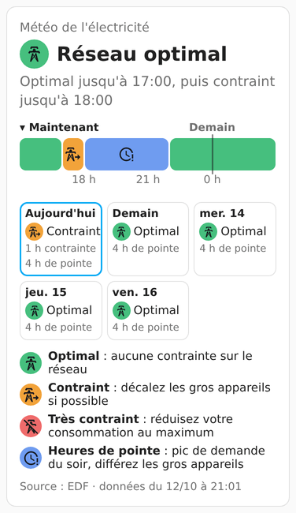
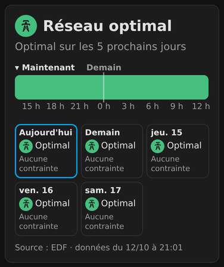

# MétéoKouran — intégration Home Assistant

La **« météo de l'électricité » de La Réunion** publiée par EDF, dans Home Assistant : des entités pour vos automatisations (signal de l'heure, du jour, de demain, prochain changement, heures de pointe de demain, cyclone signalé par EDF) et une **carte de tableau de bord** fournie avec, sans rien déclarer à la main.

<!-- ha-marketplace:exclude-start -->
[](https://my.home-assistant.io/redirect/marketplace_repository/?owner=jpgiry&repository=meteokouran-ha&category=integration)
<!-- ha-marketplace:exclude-end -->

| Thème clair, légende affichée | Thème sombre |
|---|---|
|  |  |

Quatre signaux, chacun avec son libellé et son pictogramme (jamais la couleur seule) :

| Signal | État des entités | Signification |
|---|---|---|
| **Optimal** (vert) | `vert` | aucune contrainte sur le réseau |
| **Contraint** (orange) | `orange` | décalez les gros appareils si possible |
| **Très contraint** (rouge) | `rouge` | réduisez votre consommation au maximum |
| **Heures de pointe** (bleu) | `bleu` | pic de demande du soir, différez les gros appareils |

## Installation
Il faut Home Assistant **2026.10** ou plus récent. L'intégration s'installe par le **Marketplace** (HACS avant Home Assistant 2026.11).

<!-- ha-marketplace:exclude-start -->
**Home Assistant 2026.11 et plus (Marketplace)**
1. Cliquer sur le bouton **« Open your Home Assistant instance »** ci-dessus : il ouvre le Marketplace et propose d'ajouter ce dépôt → **Ajouter**.
   Sans le bouton : Paramètres → **Marketplace** → **Ajouter grâce à un lien** → lien `https://github.com/jpgiry/meteokouran-ha`, type **Intégration**.
   Un dépôt ajouté par un lien demande une connexion GitHub, une seule fois : le Marketplace donne un code à saisir sur GitHub (lecture des données publiques seulement).
2. **Installer**, puis confirmer. Pas de redémarrage : la page de configuration de l'intégration s'ouvre aussitôt.

**Home Assistant 2026.10 (HACS)**
1. Bouton ci-dessus : il ouvre HACS avec ce dépôt prérempli.
   Sans le bouton : HACS → ⋮ (en haut à droite) → **Dépôts personnalisés** → dépôt `https://github.com/jpgiry/meteokouran-ha`, type **Intégration** → Ajouter.
2. Ouvrir « MétéoKouran » dans HACS → **Télécharger**.
3. **Redémarrer** Home Assistant (Paramètres → ⋮ → Redémarrer Home Assistant).
4. Ajouter l'intégration : bouton ci-dessous, ou Paramètres → Appareils et services → **Ajouter une intégration** → « MétéoKouran ».

   [](https://my.home-assistant.io/redirect/config_flow_start/?domain=meteokouran)

<!-- ha-marketplace:exclude-end -->

La page de configuration de l'intégration propose l'adresse de l'instance publique, **`https://meteokouran.re`** : valider. L'intégration vérifie l'adresse en lisant l'API et dit ce qui ne va pas (« injoignable », « délai dépassé », « ce n'est pas une instance MétéoKouran »).

C'est tout : les entités sont créées, et la carte est disponible dans « Ajouter une carte ». Pour changer d'adresse plus tard, sans perdre les entités : Paramètres → Appareils et services → MétéoKouran → ⋮ → **Reconfigurer**.

Une seule instance MétéoKouran par Home Assistant. L'intégration lit l'API toutes les 15 minutes (`/now`, `/cyclone`) et toutes les 30 minutes (`/forecast`), une seule requête par ressource pour toutes les entités.

## Entités
Toutes rattachées à l'appareil « MétéoKouran ». Quand l'API ne sait pas répondre, une entité est **indisponible**, jamais « off » ni « non » par défaut.

| Entité | État | Attributs |
|---|---|---|
| `sensor.meteokouran_signal_horaire` | signal de l'heure en cours (`vert`, `orange`, `rouge`, `bleu`) | `data` (heure, jour, prochain changement), `meta` (fraîcheur), `source` (licence) |
| `sensor.meteokouran_signal_du_jour` | signal de la journée | `date`, `signal` |
| `sensor.meteokouran_signal_de_demain` | signal de demain, indisponible tant qu'EDF ne l'a pas publié (vers 21 h la veille) | `date`, `signal`, `hours` (24 heures) |
| `sensor.meteokouran_prochain_changement` | heure du prochain changement de signal (horodatage), inconnu s'il n'y en a pas avant J+4 | `key`, `label` du signal suivant |
| `sensor.meteokouran_pointes_de_demain` | heures non vertes de demain par plages : « 18:00–22:00 Heures de pointe », plusieurs plages séparées par « ; », « Aucune » si tout est vert | |
| `binary_sensor.meteokouran_reseau_contraint` | `on` pour orange, rouge et bleu (heure en cours) | `key`, `label` |
| `binary_sensor.meteokouran_cyclone_en_cours` | `on` quand EDF signale un cyclone pour l'heure en cours (son champ `cyclone_en_cours` ; ce n'est pas une alerte officielle) | `depuis`, `heures_publiees_a_true`, `plage_publiee` (« 13/10 14:00 → 14/10 06:00 »), `dernier_episode` |
| `binary_sensor.meteokouran_cyclone_annonce` | `on` dès qu'EDF signale une heure, de l'heure en cours à J+4 | `premiere_heure_annoncee` |
| `sensor.meteokouran_donnees_cyclone` | `oui`, `non` ou `inconnu` : la réponse brute de `/cyclone` | `data`, `meta`, `source` |

Les entités dérivées portent aussi `attribution` et `source_updated_at` (source EDF et date de mise à jour des données, exigées par la licence).

Exemple d'automatisation : couper le chauffe-eau pendant les heures contraintes.

```yaml
triggers:
  - trigger: state
    entity_id: binary_sensor.meteokouran_reseau_contraint
    to: "on"
actions:
  - action: switch.turn_off
    target:
      entity_id: switch.chauffe_eau
```

## Carte
L'intégration fournit la carte et la charge elle-même dans le tableau de bord : **aucune ressource à déclarer**, en mode tableau de bord normal comme en mode YAML. Modifier le tableau de bord → **Ajouter une carte** → « MétéoKouran » ; toutes les options se règlent dans l'éditeur visuel. En YAML :

```yaml
type: custom:meteokouran-card
```

Sans `url`, la carte prend l'adresse configurée dans l'intégration.

| Option | Valeurs | Défaut | Rôle |
|---|---|---|---|
| `url` | adresse, sans `/api/v1` | celle de l'intégration | autre instance MétéoKouran, pour cette carte seulement ; l'emporte sur tout le reste |
| `url_entity` | identifiant d'entité | — | entité dont l'état contient l'adresse (compatibilité avec l'ancien paquet YAML) |
| `hours` | entier de 6 à 48 | `24` | longueur de la frise, en heures |
| `days` | entier de 1 à 5 | `5` | nombre de vignettes de jours |
| `show_legend` | `true` / `false` | `false` | légende des quatre signaux sous la carte |
| `title` | texte | aucun | titre au-dessus de la carte |
| `scale` | nombre de 0.8 à 1.5 | `1` | taille des textes, pictogrammes et de la frise |

- Les heures sont toujours celles de **La Réunion**, quel que soit le fuseau du téléphone ou du navigateur.
- La carte lit l'instance directement depuis le navigateur, toutes les 15 minutes et à chaque changement d'heure.
- Couleurs modifiables par un thème : `--mk-vert`, `--mk-orange`, `--mk-rouge`, `--mk-bleu`, et `--mk-ink` pour le texte posé sur ces couleurs (garder un contraste d'au moins 4,5:1).

| Message de la carte | Signification |
|---|---|
| « ⚠️ Données non actualisées depuis HH:MM » | l'instance n'a pas répondu au dernier essai ; la carte garde la dernière réponse et réessaie dans 2 minutes |
| « ⚠️ Données anciennes » | l'instance n'a pas pu lire les données d'EDF depuis plus de 26 heures |
| « Impossible de joindre MétéoKouran » | aucune réponse depuis l'ouverture de la page |
| « Adresse de MétéoKouran inconnue » | l'intégration n'est pas ajoutée et la carte n'a pas d'`url` |
| Heures hachurées, « Prévision à venir » | EDF n'a pas encore publié ces heures ou ces jours |
| Bandeau « EDF signale un cyclone en cours · depuis HH:MM » | EDF signale un cyclone pour l'heure actuelle (pas une alerte officielle) |
| Bandeau « Cyclone annoncé par EDF à partir de … » | EDF signale déjà une heure à venir (jusqu'à J+4) |

## Vous utilisiez le paquet YAML ou la carte seule ?
L'intégration remplace les deux, avec **les mêmes identifiants d'entités** : vos automatisations continuent de marcher, à condition de suivre cet ordre (sinon Home Assistant ajoute un suffixe `_2` aux nouvelles entités).

1. Noter les automatisations, scripts et cartes qui utilisent des entités `meteokouran` (Paramètres → Appareils et services → Entités, rechercher « meteokouran » → chaque entité → ⚙️ → « Utilisé par »).
2. **Retirer le paquet** : supprimer `packages/meteokouran.yaml` (ou les lignes copiées dans `configuration.yaml`) et la ligne `meteokouran_url` de `secrets.yaml`.
3. **Redémarrer** Home Assistant (Paramètres → Outils → YAML → « Vérifier la configuration », puis « Redémarrer »).
4. **Supprimer les anciennes entités** : Paramètres → Appareils et services → Entités, rechercher « meteokouran » ; elles sont marquées « non fournies » (ou « orphelines »). Bouton de sélection (à gauche de la recherche) → les cocher toutes → ⋮ → **Supprimer la sélection**. `input_text.meteokouran_url` et l'automatisation `meteokouran_refresh` ne servent plus non plus.
5. Installer l'intégration (section « Installation » ci-dessus) et l'ajouter.
6. **Vérifier** dans Paramètres → Appareils et services → Entités que les identifiants sont exactement les mêmes qu'avant, **sans `_2`**.
7. Carte seule installée depuis HACS (`meteokouran-card`) : la **désinstaller** (Home Assistant 2026.11 et plus : Paramètres → Marketplace → Installé → « MétéoKouran » de type Tableau de bord → ⋮ → Désinstaller ; 2026.10 : HACS → ⋮ → Supprimer), puis vérifier qu'il ne reste pas son ancienne ressource (Paramètres → Tableaux de bord → ⋮ → Ressources, adresse contenant `meteokouran-card.js`). Tant qu'elle est là, Home Assistant affiche une réparation « Ancienne carte MétéoKouran encore chargée ». Vos cartes `custom:meteokouran-card` restent telles quelles ; si elles contenaient `url_entity: input_text.meteokouran_url`, retirer cette ligne.
8. Recharger la page du navigateur, fermer puis rouvrir l'application mobile.

**Vous voyez des entités en `_2` ?** L'étape 4 a été sautée ou faite après l'ajout de l'intégration. Corriger : supprimer les anciennes entités (« non fournies »), puis, pour chaque entité en `_2`, ⚙️ → Identifiant de l'entité → retirer `_2` → Mettre à jour. Rien n'est perdu : les automatisations retrouvent leurs entités.

## Source des données et licences
- **Données** : EDF Réunion, jeu « Météo de l’électricité - Réunion » du portail https://opendata-reunion.edf.fr, sous **Licence Ouverte Etalab 2.0**. Les entités gardent la source et la date de mise à jour des données (`attribution`, `source_updated_at`), et le pied de la carte affiche toujours « Source : EDF » avec cette date, comme l'exige la licence : ne pas les masquer.
- L'intégration ne lit pas EDF directement : elle interroge une **instance MétéoKouran**, le service qui collecte et archive ces données. Instance publique : `https://meteokouran.re`.
- MétéoKouran est un projet indépendant, **sans lien avec EDF**. Ni le logo ni les visuels de l'application EDF ne sont utilisés : palette, pictogrammes (Material Design Icons), icône et textes sont propres au projet.
- **Code** (intégration et carte) : licence MIT (fichier `LICENSE`).
